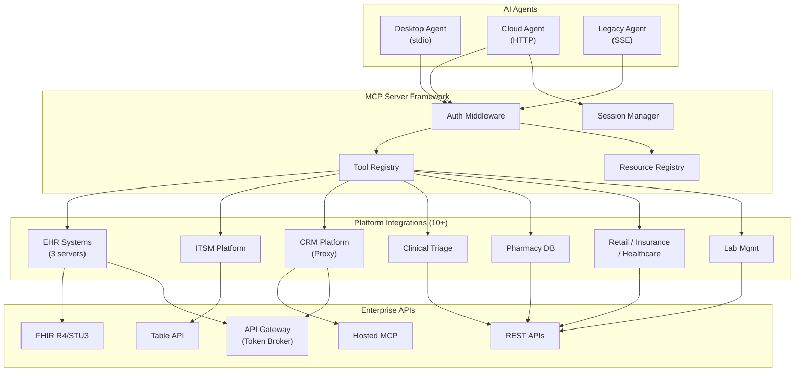

# Enterprise MCP Server Architecture — Case Study

## Overview

Designed and built a production MCP (Model Context Protocol) server framework powering 10+ enterprise platform integrations across healthcare, ITSM, CRM, retail, insurance, clinical triage, and pharmacy domains. The framework enables AI agents to interact with enterprise systems through a standardized protocol — exposing platform-specific operations as discoverable, schema-validated tools that agents can invoke in real time.

The architecture serves as the integration backbone for AI-powered enterprise workflows, connecting conversational AI agents to backend systems that manage patient records, service incidents, customer data, insurance policies, clinical triage sessions, and lab infrastructure. Each integration is a standalone MCP server sharing a common framework pattern, deployable independently as containerized microservices on cloud infrastructure.

At full build-out, the ecosystem includes 11 production MCP servers exposing over 150 tools across 8 enterprise platform categories, supporting three transport protocols, five authentication strategies, and automated CI/CD deployment to serverless container infrastructure.

---

## The Problem

Enterprise organizations rely on dozens of backend platforms — EHR systems, ITSM tools, CRM platforms, clinical triage engines, pharmacy databases, and custom internal systems. AI agents need to interact with all of them, but each platform has its own API conventions, authentication models, data formats, and error behaviors.

The challenge was threefold:

1. **No standard integration protocol** — Each AI-to-platform integration was custom-built, creating N×M complexity between agents and systems.
2. **Authentication diversity** — Enterprise APIs use everything from API keys to OAuth2 browser flows to token broker gateways. A unified abstraction was needed.
3. **Deployment at scale** — Each integration needed to run independently, deploy via CI/CD, scale on demand, and operate in both local development and cloud production environments without code changes.

Existing approaches (custom REST wrappers, hardcoded integrations) didn't scale. What was needed was a framework — a repeatable pattern for building enterprise AI integrations that any developer could follow to add a new platform in days, not weeks.

---

## Architecture

### High-Level Design

> Full architecture diagrams with authentication flows, request lifecycle, and deployment topology available in [`/architecture/diagrams.md`](architecture/diagrams.md).

### Platform Integrations

| Integration | Domain | Tools | Auth Model | Key Technical Challenge |
|---|---|---|---|---|
| EHR (Patient-Facing) | Healthcare | 17 | OAuth2 via Gateway + Local | FHIR R4 query mapping, stale cache fallback, research API aggregation |
| EHR (Clinical) | Healthcare | 50+ | OAuth2 via Gateway + Local | Dual FHIR versions (R4 + STU3), write operations, 40+ response formatters |
| EHR (Agent Care) | Healthcare | 17 | OAuth2 Browser Flow | TypeScript, NLP query parsing, clinical prompt builders, multi-EMR support |
| ITSM | IT Service Management | 21 | Basic / OAuth / API Key | Dual identifier resolution (business ID vs system ID), query builder |
| CRM (Proxy) | Customer Relationship | Dynamic | Gateway Token + Proxy | Transparent MCP-to-MCP forwarding, session mapping, 401 token refresh |
| Clinical Triage | Healthcare | 14 | API Key | NLP symptom detection, 3 conversation modes, payload trimming |
| Pharmacy Database | Pharmaceutical | 3 | None (Public API) | Retry with exponential backoff, correlation IDs, TTL caching |
| Retail | Commerce | 5 | API Key / JWT | Standard CRUD, multi-transport deployment |
| Insurance | Financial Services | 5 | API Key / JWT | Policy lifecycle management, dual client support |
| Healthcare (Custom) | Healthcare | 5 | API Key / JWT | Patient record management, custom API gateway |
| Lab Pod Management | Infrastructure | 16 | API Key / JWT | Multi-collection architecture, keyword management |

### Framework Design

The framework follows a **shared-pattern, independent-deployment** model. Each MCP server is a standalone Node.js application that follows the same architectural pattern but deploys and scales independently.

**What's shared (by convention, not by code dependency):**
- Server initialization pattern (MCP SDK + Express)
- Multi-transport support (stdio, SSE, Streamable HTTP)
- Authentication middleware pattern
- Tool registration and dispatch pattern
- API client singleton pattern
- Configuration management approach
- Docker build template
- CI/CD pipeline template
- Health check endpoint convention

**What's platform-specific:**
- Tool definitions and schemas
- API client implementation
- Authentication strategy (API key, JWT, OAuth2, Basic, Proxy)
- Response formatting logic
- Error handling nuances (retry strategy, cache fallback, payload trimming)

This design was intentional — a shared library or monorepo would have created deployment coupling. By keeping each server independent, teams can modify, deploy, and scale any integration without affecting others.

---

## Design Decisions

### 1. Framework Pattern vs Shared Library

**Decision:** Repeatable pattern rather than a shared npm package or monorepo.

**Why:** Each integration team needs to deploy independently. A shared library creates version coupling — updating the core means redeploying everything. The pattern approach lets teams copy the template, customize for their platform, and own their deployment lifecycle.

**Trade-off:** Some code duplication across servers (tool dispatch boilerplate, auth middleware). Accepted this in exchange for deployment independence and operational isolation.

### 2. Multi-Transport Architecture

**Decision:** Every server supports three transport protocols — stdio, SSE, and Streamable HTTP — from a single codebase.

**Why:** Different deployment contexts require different transports. Desktop agents need stdio (local process communication). Cloud agents need HTTP (network-based, session-managed). Legacy agents need SSE (unidirectional streaming). Supporting all three from the same tool definitions means zero code duplication for the business logic.

**Trade-off:** Three entry points per server adds file count. Mitigated by keeping transport logic thin — each is <100 lines wrapping the same MCP server instance.

### 3. Authentication Abstraction

**Decision:** Five authentication strategies behind a single `AuthManager` interface. Tool handlers call `authorize()` without knowing which strategy is active.

**Why:** Enterprise APIs use wildly different auth models. EHR platforms require OAuth2 with PKCE. ITSM platforms support Basic auth. CRM platforms use token broker gateways. The abstraction lets tool handlers stay clean while the auth layer handles the complexity.

**Strategies implemented:**
- API Key (header injection)
- JWT Bearer Token
- Basic Authentication (Base64)
- OAuth2 via API Gateway (token broker with caching)
- OAuth2 Local Browser Flow (development mode with callback server)

### 4. MCP Proxy Pattern (CRM)

**Decision:** Instead of implementing CRM tools directly, built a transparent MCP proxy that forwards requests to the CRM platform's own hosted MCP server.

**Why:** The CRM platform already exposed its own MCP server. Re-implementing those tools would be wasteful and fragile (breaking on upstream changes). The proxy pattern adds enterprise authentication (the CRM's MCP server doesn't handle enterprise auth natively) and session management while transparently relaying all tool definitions and calls.

**Trade-off:** Added latency (extra network hop). Accepted because the auth injection and session management were non-negotiable requirements.

### 5. Stale Cache Fallback

**Decision:** EHR and clinical integrations cache API responses (1-hour TTL) and return stale cached data when the upstream API errors.

**Why:** Healthcare workflows can't simply fail when an EHR API has a transient error. Returning slightly-stale patient data is better than returning nothing. The response includes a warning flag so the agent knows the data may not be current.

**Trade-off:** Agents may act on outdated data during API outages. Mitigated by short TTL (1 hour) and explicit staleness warnings.

### 6. Retry with Exponential Backoff (Selective)

**Decision:** Only the pharmacy/drug database integration implements retry with backoff. Other integrations fail fast.

**Why:** The pharmacy API is a public third-party service with known transient failures. Retry makes sense. Enterprise APIs (EHR, ITSM) have different failure modes — a 401 means "re-authenticate," not "try again." Retrying blindly against enterprise APIs can cause account lockouts or rate limit escalation.

**Trade-off:** Simpler error handling for most integrations, but less resilience against transient network issues. Accepted because the cache fallback pattern handles most transient scenarios.

### 7. Modular Tool Definitions (High-Tool-Count Servers)

**Decision:** Servers with 20+ tools extract definitions to a separate `tools.js` module. Simpler servers define tools inline.

**Why:** The clinical EHR server has 50+ tools. Keeping those definitions inline in the server file would make it unreadable. Extracting to a module enables shared definitions across transport entry points and separates tool schema from dispatch logic.

### 8. Container-Native Configuration

**Decision:** All configuration via environment variables. No YAML/JSON config files. Cloud Secrets Manager for production secrets.

**Why:** Container orchestrators (ECS, Kubernetes) inject configuration via environment variables. Adding config file parsing adds complexity without benefit. Secrets Manager provides encryption, rotation, and audit logging that `.env` files can't.

### 9. Per-Server CI/CD Pipeline

**Decision:** Each MCP server has its own GitHub Actions workflow. Push to main triggers build, push to container registry, and deploy to cloud.

**Why:** Independent deployment lifecycle. Updating the ITSM integration shouldn't require redeploying the EHR servers. Each pipeline is identical in structure but targets different container registries and task definitions.

---

## Technical Patterns

Detailed, sanitized design patterns with pseudocode are documented in the [`/patterns/`](patterns/) directory:

| Pattern | Description |
|---|---|
| [Server Framework](patterns/server-framework.md) | Multi-transport server architecture with shared tool definitions |
| [Tool Registration](patterns/tool-registration.md) | Static and dynamic tool registration, dispatch, and proxy patterns |
| [Authentication](patterns/authentication.md) | Five auth strategies behind a unified abstraction layer |
| [API Integration](patterns/api-integration.md) | FHIR, ITSM, proxy, caching, retry, and formatting patterns |
| [Configuration](patterns/configuration.md) | Environment-based config with cloud secrets manager integration |
| [Deployment](patterns/deployment.md) | Docker, CI/CD, and cloud container deployment patterns |

---

## Technical Stack

| Layer | Technology |
|---|---|
| **Language** | JavaScript (ES Modules) / TypeScript |
| **Runtime** | Node.js 18+ |
| **Protocol** | Model Context Protocol (MCP) via `@modelcontextprotocol/sdk` |
| **Transports** | stdio, SSE, Streamable HTTP |
| **HTTP Framework** | Express.js |
| **HTTP Client** | Axios, node-fetch (native fetch in Node 18+) |
| **Authentication** | simple-oauth2, custom OAuth2 implementations |
| **Caching** | node-cache (in-memory, TTL-based) |
| **Containerization** | Docker (multi-stage Alpine builds) |
| **Orchestration** | AWS ECS Fargate |
| **CI/CD** | GitHub Actions |
| **Secrets** | AWS Secrets Manager |
| **Logging** | AWS CloudWatch |
| **Load Balancing** | AWS Application Load Balancer |

---

## Impact

- **11 production MCP servers** deployed and operational, covering 8 enterprise platform categories
- **150+ tools** exposed to AI agents across healthcare, ITSM, CRM, retail, insurance, and infrastructure domains
- **50+ tools** on the most complex single server (clinical EHR), supporting read and write operations across 22+ FHIR resource types
- **3 transport protocols** supported per server, enabling deployment flexibility from local desktop to cloud production
- **5 authentication strategies** abstracted behind a single interface, handling everything from API keys to OAuth2 browser flows
- New platform integrations follow the established pattern and can be built and deployed in **days rather than weeks** — the framework pattern eliminates boilerplate design decisions
- All servers deploy independently via automated CI/CD pipelines, with zero cross-server deployment dependencies

---

## Lessons Learned

### 1. Convention Over Shared Code at Scale
With 11 servers maintained independently, a shared library would have become a bottleneck. The pattern-based approach — where each server follows the same conventions without importing shared code — proved more scalable for independent teams. The trade-off (some duplication) was worth the deployment independence.

### 2. Multi-Transport Is Non-Negotiable for Enterprise
Every deployment context has different transport requirements. Desktop development needs stdio. Cloud production needs HTTP with sessions. Legacy systems need SSE. Building all three from day one avoided painful retrofits. The key insight: keep transport logic thin and business logic transport-agnostic.

### 3. Authentication Is the Hardest Part
More engineering time went into auth than any other feature. Enterprise APIs use every authentication model imaginable, and each has edge cases — token expiry timing, refresh token rotation, browser flow timeouts, gateway token caching, 401 retry logic. The `AuthManager` abstraction was the highest-value architectural decision in the framework.

### 4. Cache Fallback Beats Retry for Enterprise APIs
Retry with backoff is the standard pattern for transient failures, but enterprise APIs have different failure semantics. A 401 means "re-authenticate." A 403 means "you don't have permission." A 500 might mean "your query is malformed." Blind retry is counterproductive. Cache fallback with staleness warnings proved more appropriate for most enterprise integrations.

### 5. Proxy Patterns Unlock Hosted MCP Servers
When a platform already exposes its own MCP server, building a proxy is dramatically simpler than re-implementing all tools. The proxy adds enterprise auth, session management, and observability while preserving complete compatibility with the upstream tool definitions. This pattern should be the default approach when an upstream MCP server exists.
