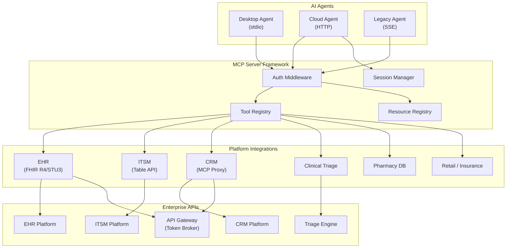
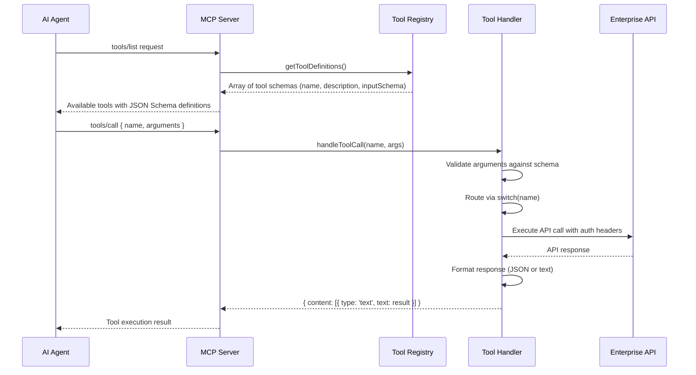
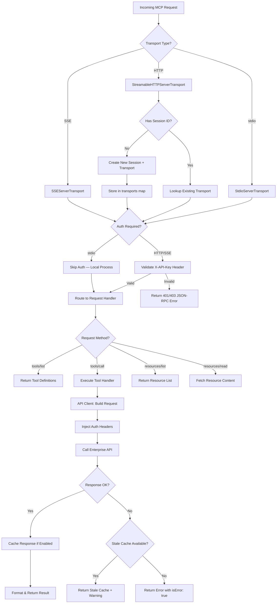
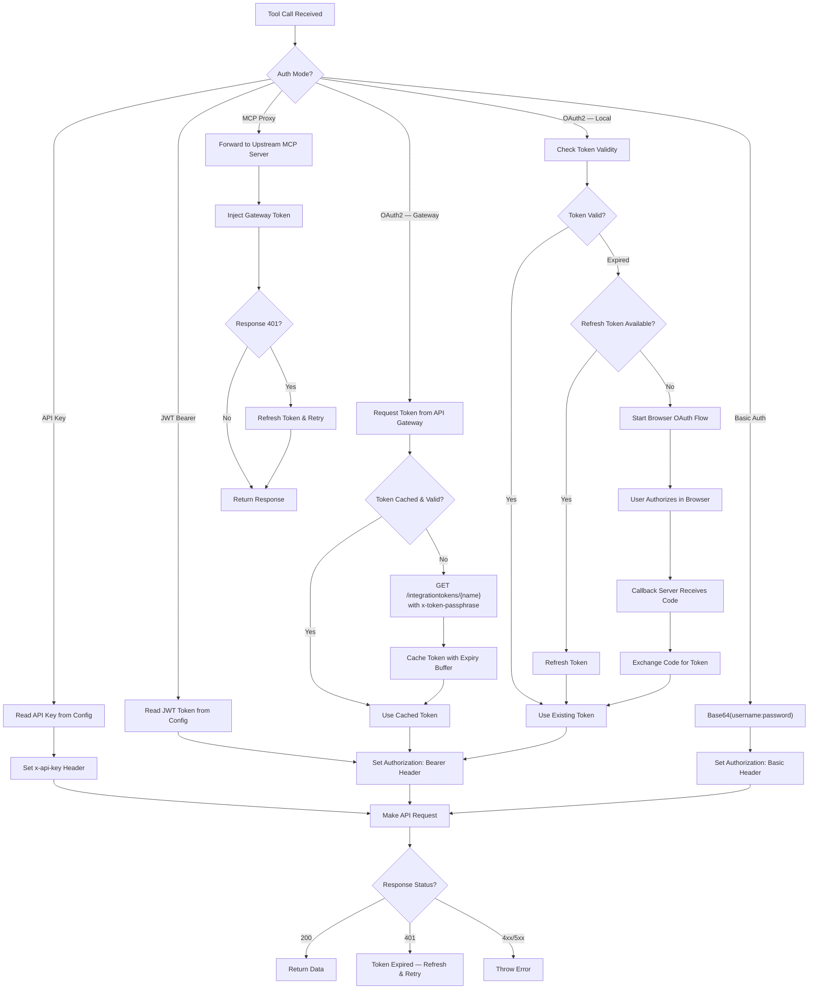
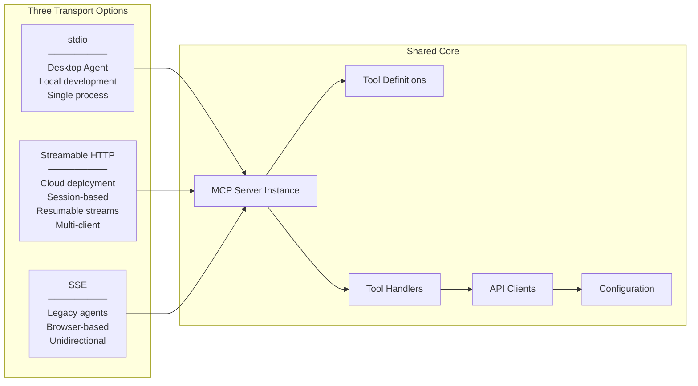
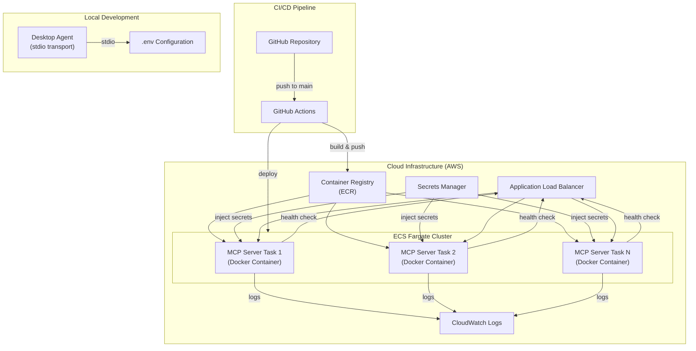

# Architecture Diagrams

Visual documentation of the enterprise MCP server framework architecture.

---

## 1. High-Level System Architecture

---

## 2. Tool Registration and Discovery Flow

---

## 3. Request Lifecycle

---

## 4. Authentication Flow Abstraction

---

## 5. Multi-Transport Architecture

---

## 6. Deployment Architecture

---

## 7. Platform Integration Comparison

| Integration | Tools | Auth Model | Complexity | Key Pattern |
|---|---|---|---|---|
| EHR (Patient-facing) | 17 | OAuth2 (Gateway + Local) | High | FHIR R4, research APIs, caching |
| EHR (Clinical) | 50+ | OAuth2 (Gateway + Local) | Very High | FHIR R4+STU3, write ops, 40+ formatters |
| EHR (Agent Care) | 17 | OAuth2 (Browser Flow) | High | TypeScript, NLP query parsing, prompts |
| ITSM | 21 | Basic / OAuth / API Key | Medium | Table API queries, ID resolution |
| CRM (Proxy) | Dynamic | Gateway Token + Proxy | High | Transparent MCP proxy, session mapping |
| Clinical Triage | 14 | API Key | Medium | NLP intake, 3 conversation modes, trimming |
| Pharmacy DB | 3 | None (Public API) | Low | Retry + backoff, TTL caching |
| Retail / Insurance | 5 each | API Key / JWT | Low | Standard CRUD, multi-transport |
| Lab Pod Mgmt | 16 | API Key / JWT | Medium | Multi-collection, keyword management |
